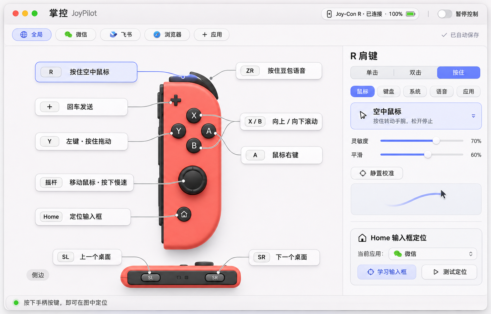

# 掌控 JoyPilot

**一只右 Joy-Con，让 Mac 的鼠标、语音、桌面切换和快捷键都在手边。**

JoyPilot 是独立的 macOS 原生应用，使用 SwiftUI + AppKit。界面以可交互的右手柄图呈现按键：点击实物位置或动作卡即可编辑；手柄按下时实时高亮。无需安装 Berrry Joyful 或 SayAll。

> **0.1.0 实验版本。** 核心自动化与本地构建可复现；真实设备、输入法和应用兼容性的验收边界见 [验证记录](docs/VALIDATION.md)。不要把“事件已发送”当作第三方应用完成操作的证明。



## 默认操作

| 控件 | 功能 |
|---|---|
| 摇杆 | 移动鼠标 |
| 按下摇杆 | 按住慢速微调 |
| Y / A | 左键（按住可拖动）/ 右键 |
| X / B | 按住向上 / 向下滚动 |
| ZR | 语音工具触发，默认豆包右 Command 按住说话 |
| R | 按住开启陀螺仪空中鼠标，松开停止 |
| ＋ | Return 回车发送 |
| Home | 定位当前应用输入框 |
| 侧边 SL / SR | 上一个 / 下一个桌面 |

**R 组合层：** R＋X 窗口总览、R＋B 显示桌面、R＋＋退格、R＋Home 切换应用、R＋SL/SR 切换标签页。R＋Y/A 保留点击，方便空中鼠标操作。ZR 语音期间抑制其他动作，避免组合成误操作。

可在 Home 的“双击”配置“切换应用”，在“长按”配置窗口选择入口。如果“窗口总览”动作发送后没有展开窗口，可将该手势改为“打开应用”，选择系统“调度中心”（`/System/Applications/Mission Control.app`），直接调用系统入口。本机已通过用户实测；原“窗口总览”动作仍使用 Control＋上箭头，效果受系统快捷键配置及事件响应影响。

## 功能

- 原生中文单页界面，设备图、动作卡、基础 / R 组合层、实时按键状态。
- 全局默认和按应用覆盖；修改自动保存，缺省设置继承全局。
- 鼠标拖动、右键、多显示器边界、慢速定位。
- 时间驱动的低速滚动，保留小数余量，速度 0.1 / 0.25 / 0.5 不会被截成零。
- 右 Joy-Con 陀螺仪相对指向、静置零偏校准、平滑、反向设置。
- 单击、双击、长按动作，以及退格、Tab、音量和自定义快捷键的按住连发。连续动作立即按下 / 松开，不等待双击判定。
- 桌面、窗口总览、应用切换、打开指定应用、音量 / 静音 / 播放控制、基础键盘动作及可录制自定义快捷键。
- 输入框学习、按应用配置聚焦快捷键、辅助功能树准备、有限重试和焦点校验。
- 菜单栏驻留；暂停、断连、睡眠、前台切换及退出时清理合成按键。

### 语音工具

JoyPilot **不录音、不识别语音、不保存录音或 API Key**。音频由系统 / 大疆等现有麦克风直接送入你选择的语音工具。

参考无线麦 SayAll 的公开能力矩阵，区分工具而不是统一发送一个 Fn：

| 工具预设 | 初始快捷键 | 初始触发方式 | 状态 |
|---|---|---|---|
| 豆包输入法 | 右 Command | 按住 | 本机新应用基础试用获用户初步正常反馈，见验证记录 |
| 微信输入法 | 右 Command | 按住 | 可编辑预设，需与输入法实际设置对齐并测试 |
| Typeless | Fn | 点按开始 / 结束 | 可编辑预设，未作本机语音验收 |
| Vokie | Fn | 点按开始 / 结束 | 可编辑预设，未作本机语音验收 |
| 其他工具 | 用户录制 | 用户选择 | 需自行测试 |

支持“按住说话”“点按开始 / 结束”“按住转两次点按”。工具的默认快捷键会变，**应以你在工具内设置的快捷键为准**。没有检测到应用不代表不兼容；被检测到也不代表完成了语音验证。选择输入法和麦克风在对应工具或系统设置中完成。

### Home 输入框学习

1. 打开目标应用，切到需要输入的页面。
2. 在 JoyPilot 选对应应用（或全局使用最近的目标应用），点“学习输入框”。
3. 在三秒内点击目标输入框；应用会记录控件结构和相对几何，不读取文本内容来匹配。
4. 再按 Home 或“测试定位”。只有实际焦点校验通过才显示成功。

也可为应用录制它已有的聚焦快捷键。浏览器、微信、飞书版本的辅助功能支持不同，无法承诺所有输入框都能定位；页面变动后可能需要重新学习。没有匹配到已学习控件时，不盲目点击固定屏幕位置。

### 体感

先静置校准，再按住 R 转动手腕。默认按竖握右手柄映射水平与垂直转动，支持反转轴和灵敏度调整。它是**相对空中鼠标**，不是精确的 3D 空间定位。松手重新调整握姿后再按住继续；语音优先于体感。

## 构建与运行

要求 macOS 14+、Xcode / Apple Swift 5.9+ 工具链。无远程 SwiftPM 依赖，硬件库已随源码提供。

```sh
swift test
scripts/build-app.sh
open build/JoyPilot.app
```

当前构建产物跟随本机架构；Apple Silicon 已作本地构建。Intel 应从源码构建并独立测试。

要把中间产物放到其他目录：

```sh
JOYPILOT_BUILD_ROOT=/absolute/build/path scripts/build-app.sh
```

安装到 Applications 后退出其他接管同一只 Joy-Con 的程序，只运行一个控制器。第一次在系统设置中为“掌控 JoyPilot”开启辅助功能 / 设备控制和数据访问权限。本应用无需麦克风或语音识别权限。

### 签名

构建脚本默认临时签名，适合本地开发。重新构建后系统可能要求重新添加权限。可用 `JOYPILOT_SIGN_IDENTITY` 指定你自己已有的稳定签名身份。公开源码不携带证书、密钥或开发者凭据；本仓库不宣称临时签名开发包已通过 Apple 公证。正式分发应使用 Developer ID 签名与公证。

## 参考与许可

特别感谢 **[无线麦 SayAll / HD838A/remote-mic-app](https://github.com/HD838A/remote-mic-app)**。JoyPilot 的可视化按键卡片、动作分类、手势生命周期、输入框学习与不同语音工具能力区分，参考了该项目公开源码和设计。本项目按 GPL-3.0-only 开源，参见 [LICENSE](LICENSE)。我们没有打包 SayAll 的专有图标、私有会员模块、音频驱动或用户配置。

硬件通信使用 **[JoyConSwift / magicien](https://github.com/magicien/JoyConSwift)**（MIT），来源于 **[Berrry Joyful](https://github.com/Berrry-Computer/berrry-joyful)** 的修复版本；MIT 版权声明均随源码保留。完整说明见 [THIRD_PARTY_NOTICES.md](THIRD_PARTY_NOTICES.md)。

## 架构与边界

- `JoyPilotCore`：纯输入路由、分应用配置、R 层、手势、小数滚动、体感数学、平衡快捷键计划。
- `JoyPilot/UI`：手柄矢量画布、编辑器、动作分类、快捷键录制。
- `JoyPilot/Services`：系统事件投递、焦点学习和校验、外部语音工具桥接。
- `JoyPilot/Hardware/JoyConSwift`：右 Joy-Con HID 与传感器通信。

本版不包含：小米遥控器内置收音、虚拟麦克风驱动、Siri Remote / Chromecast / 手机支持、云端转写、多步宏动作库、会员服务或自动更新。这些不会因为引用上游项目而自动获得。
